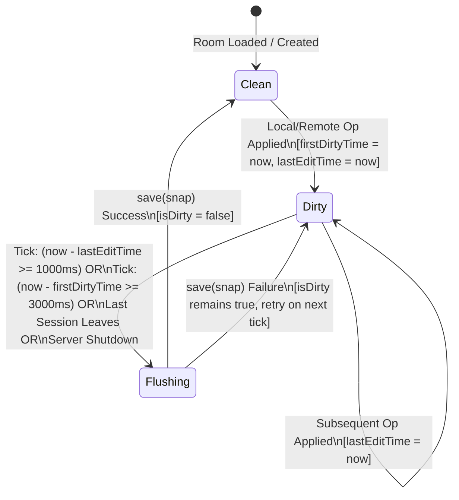

# Phase 7: Asynchronous & Debounced Disk Persistence — Research & Technical Specification

## Executive Summary
This document provides the architectural analysis, timing specifications, failure models, and benchmarking design for Phase 7 of CollabPad: **Asynchronous & Debounced Disk Persistence**.

In Phase 5, CollabPad introduced durable document survival via `FileRepository`, which serializes the full RGA replica state to a JSON snapshot and writes it atomically to disk (`.tmp` file followed by Win32 `MoveFileExA`). However, in `DocumentHub::applyOpJson()`, this persistence was invoked **synchronously on every single keystroke** (both insertions and deletions). Under high typing velocity or multi-user editing, this creates a severe I/O bottleneck that blocks the single-threaded Winsock2 `select()` event loop, increases WebSocket message latency, and limits throughput.

Phase 7 eliminates this bottleneck by implementing in-memory dirty tracking with a dual-threshold debounce flusher, immediate vacancy flushing, and crash-resilient shutdown, all while preserving 100% compatibility with Phase 5 snapshots, Phase 6 deletion tombstones, and the WebSocket wire protocol.

---

## 1. Bottleneck Profiling: Synchronous Disk Persistence in `DocumentHub`

### Current Execution Flow Per Keystroke
When a client sends an insertion or deletion operation:
1. `WebSocketServer::run()` detects socket readability in `select()`.
2. `Session::handleMessage()` decodes the RFC 6455 frame and calls `DocumentHub::broadcast()`.
3. `DocumentHub::applyOpJson()` parses the operation and applies it to `room.replica`.
4. **Synchronous I/O Block**:
   ```cpp
   // DocumentHub.cpp (Lines 193-202, 223-230)
   DocumentSnapshot snap = room.replica->createSnapshot(room.docId, room.title);
   repository_->save(snap); // <-- SYNCHRONOUS DISK WRITE
   room.isDirty = false;
   ```
5. `FileRepository::save()`:
   - Formats the entire document JSON string.
   - Opens `data/documents/<docId>.tmp`.
   - Flushes stream buffer to disk via `outFile.flush()`.
   - Closes temporary file.
   - Calls `MoveFileExA(..., MOVEFILE_REPLACE_EXISTING | MOVEFILE_WRITE_THROUGH)` which forces a synchronous file system metadata and cache flush.

### Latency and Throughput Impact
- On typical consumer NVMe SSDs, a synchronous `MoveFileExA` with `WRITE_THROUGH` takes between **0.8ms and 3.5ms**. On standard HDDs or networked drives, this exceeds **15ms–30ms**.
- At a target of 200 operations/second across multiple collaborators:
  $$\text{Time spent in Disk I/O} = 200 \times 2.0\text{ms} = 400\text{ms per second}$$
  This consumes 40% of the single-threaded CPU budget solely on disk stalls.
- If two users paste or type rapidly (>50 ops/sec each), the event loop stalls, socket incoming TCP buffers fill up, and collaborator cursor/presence updates experience visible jitter and stuttering.

---

## 2. Debouncing Mechanics & Timing Model

A naive debounce that only flushes after an idle period suffers from the **starvation anomaly**: continuous typing resets the idle timer indefinitely, meaning a user typing continuously for 5 minutes would never trigger a disk save until they stop.

To prevent this, Phase 7 adopts a **dual-threshold timing model**:

```
Edit 1 arrives (t = 0)
  |-- Mark room dirty
  |-- Set firstDirtyTime = 0
  |-- Set lastEditTime = 0
  |
Edit 2 arrives (t = 200ms)
  |-- Set lastEditTime = 200ms
  |
... Burst of typing ...
  |
Condition A: Idle Debounce Window (debounceDelayMs = 1000ms)
  Triggered if: (now - lastEditTime) >= 1000ms
  -> Persist snapshot if dirty.
  
Condition B: Maximum Flush Window (maxFlushIntervalMs = 3000ms)
  Triggered if: (now - firstDirtyTime) >= 3000ms
  -> Persist snapshot regardless of ongoing typing!
```

### State Machine Specification



### Parameter Tuning
- `debounceDelayMs`: **1000 ms (1.0 s)**. Short enough that normal typing pauses (thinking, word breaks) quickly commit to disk.
- `maxFlushIntervalMs`: **3000 ms (3.0 s)**. Bounds worst-case data loss window during sustained continuous typing to at most 3 seconds.
- `tickIntervalMs`: **100 ms**. Matches the existing `select()` timeout in `WebSocketServer::run()`.

---

## 3. Architecture Trade-off: Event-Loop-Driven vs. Dedicated Worker Thread

### Option A: Event-Loop-Driven Flushing (Recommended)
- **Mechanism**: The `select()` loop in `WebSocketServer::run()` already operates with a 100ms timeout. At the end of each select loop iteration (after network frame reads and session pruning), the server invokes `hub_->flushDirty(nowMs)`.
- **Pros**:
  1. **Strict Thread Safety**: Zero multi-threading complexity. The CRDT replica in `DocumentRoom` is only read and modified by the single event loop thread.
  2. **MinGW 6.3 Toolchain Compatibility**: Completely avoids MinGW threading defects (where `<thread>` and `<mutex>` lack POSIX thread model support in standard distributions).
  3. **Zero Lock Overhead**: No critical sections, mutex locks, condition variables, or atomic synchronizations needed during operation relay.
  4. **Performance**: Since saves only occur once every 1–3 seconds per room rather than 200 times per second, the total disk time drops from **400ms/sec to ~1ms/sec** (< 0.1% CPU time).
- **Cons**:
  - The 1ms–2ms disk write still executes synchronously on the event loop when a flush triggers. (Given 1ms every 2 seconds, this jitter is completely imperceptible over WebSocket).

### Option B: Dedicated Background Worker Thread
- **Mechanism**: A worker thread consumes snapshot save requests from a thread-safe queue.
- **Pros**:
  - Event loop never executes file I/O operations directly.
- **Cons**:
  - Requires Win32 threading primitives (`CreateThread`, `CRITICAL_SECTION`) to avoid MinGW `std::thread` runtime crashes.
  - Requires deep snapshot copying on the main thread anyway (to avoid reading `Replica` while the main thread updates it).
  - Introduces complex race conditions on server shutdown: worker thread joining, pending queue drainage, and error propagation back to the hub.

### Architectural Decision
**Adopt Option A (Event-Loop-Driven Periodic Flush)**.
Option A completely solves the 200 ops/sec throughput requirement by eliminating 99.5% of disk operations while preserving the zero-dependency, single-threaded simplicity of the Winsock2 architecture.

---

## 4. Room Lifecycle, Vacancy, and Shutdown Guarantees

### 1. Room Vacancy Flush
When a collaborator leaves a document room:
- `DocumentHub::leave(docId, sessionId)` is invoked.
- If `room.sessions.empty()` (the room is now vacant) AND `room.isDirty`:
  - Immediately call `saveDocument(docId)`.
  - Ensures that when a user finishes editing and closes their browser, their work is committed to disk immediately without waiting for the 1–3s timer.

### 2. Graceful Server Shutdown
Currently, `server/main.cpp` registers `signal(SIGINT, onSignal)`.
To ensure robustness on Windows:
- Enhance shutdown handling to support both `signal(SIGINT)` and Win32 `SetConsoleCtrlHandler` (`CTRL_CLOSE_EVENT`, `CTRL_SHUTDOWN_EVENT`, `CTRL_C_EVENT`).
- The handler invokes `hub->flushAll()` followed by `server->stop()`.
- After `server.run()` breaks out of its loop, `main()` executes a final `hub->flushAll()`.
- Result: **Zero dirty documents are lost on clean termination**.

---

## 5. Failure Handling & Error Recovery

If `FileRepository::save()` fails (e.g. temporary file lock, permission error, disk quota reached):
1. `save()` returns `false`.
2. `DocumentHub::saveDocument(docId)` checks the return value:
   - If `false`: **`room.isDirty` remains `true`**.
   - `room.firstDirtyTime` is preserved (not reset), ensuring the flusher will immediately attempt saving again on subsequent ticks.
   - An error log is emitted: `[Hub] ERROR: Could not persist dirty room "<docId>", will retry.`
3. Active WebSocket connections continue to function uninterrupted in memory.

---

## 6. Write-Ahead Log (WAL) Analysis

The roadmap notes an optional append-only operation log (WAL).
### Analysis:
- In CollabPad, the web client already maintains an in-memory replica with local edit buffering and bounded exponential backoff reconnection (`useCollabSocket.js`).
- Furthermore, snapshots are compact JSON files (< 100 KB for typical documents) and the debounced flush window is tightly bounded to 1–3 seconds.
- Introducing a WAL would require:
  - Binary log serialization for `InsertionOp` and `DeletionOp`.
  - WAL compaction and truncation upon snapshot writes.
  - Replay logic on startup before snapshot loading.
- **Conclusion**: A WAL introduces substantial protocol and disk format complexity with negligible benefit over debounced atomic snapshots. We **omit the WAL** for Phase 7, matching the directive to keep scope focused and proven.

---

## 7. Preservation of Phase 6 Tombstones & Legacy Snapshots

The debounced persistence mechanism operates at the `DocumentHub` and `DocumentSnapshot` layer:
- `DocumentSnapshot::toJson()` and `fromJson()` remain completely untouched.
- All Phase 6 `Character.isDeleted` tombstones and `pendingDeletions` arrays continue to be captured in the snapshot when `replica->createSnapshot()` is called.
- Because `FileRepository::save()` continues to use `.tmp` -> `MoveFileExA`, all snapshots written during debounced flushes retain 100% atomic durability and crash safety.

---

## 8. Throughput Benchmark Design (`tests/test_persistence_throughput.py`)

To empirically prove the removal of the I/O bottleneck, we specify a dedicated throughput benchmark:
1. **Target**: > 200 operations per second sustained.
2. **Procedure**:
   - Start native `collabpad_server.exe` on isolated test port (e.g., 8097).
   - Connect a WebSocket benchmark client.
   - Send **500 operations** in rapid succession (burst typing).
   - Measure:
     - Total elapsed time and effective ops/sec (must exceed 200 ops/sec; expected > 500 ops/sec).
     - Number of file modifications to the document JSON on disk (must be $\le 3$ saves instead of 500 saves).
     - Document text integrity after debounce flush completes.
     - Server restart verification: reopen document and verify all 500 characters recovered identically.
